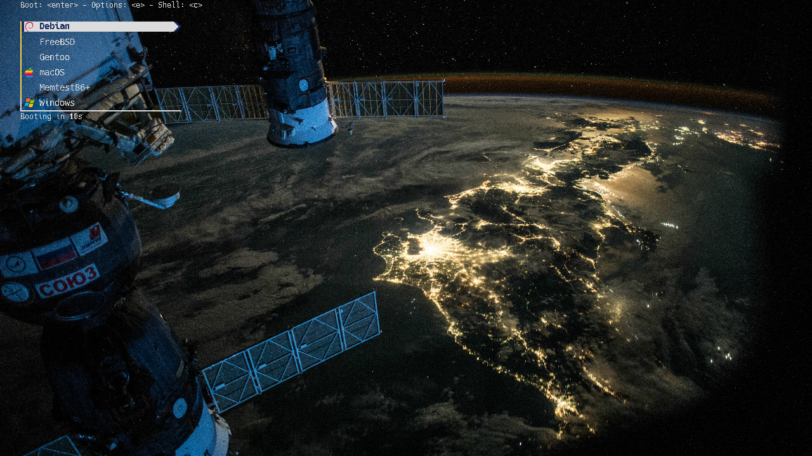

# Space Grub Theme 🛰️

A sleek space theme for grub.



- Background image: [NASA](https://www.flickr.com/photos/nasacommons/54678083846/)
- Font: [Hack](https://github.com/source-foundry/hack)
- Icons: look [here](icons.toml)

## Install
### NixOS
Add this to the `inputs` in your configuration `flake.nix`
```nix
space-grub-theme.url = "github:Maloschnikow/space-grub-theme";
```
And in your configuration set
```nix
boot.loader.grub.theme = "${inputs.space-grub-theme.packages.${pkgs.stdenv.hostPlatform.system}.default}";
```

### Other Distros
Sorry, I can't help you with this.
Downloading the contents of this repo should be a good first step. I'm sure you can figure out the rest too, I believe in you!


## Development

Open a development shell with
```shell
nix develop
```

Preview with [grub2-theme-preview](https://github.com/hartwork/grub2-theme-preview):
```shell
uv tool run --from grub2-theme-preview grub2-theme-preview ./. --verbose --resolution 1920x1080
```

Convert `.ttf` to `.pf2` with:
```shell
grub-mkfont -o Hack-14.pf2 -s 14 ttf/Hack-Regular.ttf
```

Convert `.svg` to `.png` with [ImageMagick](https://github.com/imagemagick/imagemagick):
```shell
# mkicon is a custom script, look into nix/scripts.nix for details
mkicon https://brand.nixos.org/logos/nixos-logomark-rainbow-flat-recommended.svg nixos
# Regenerate all icons
mk-all-icons
```